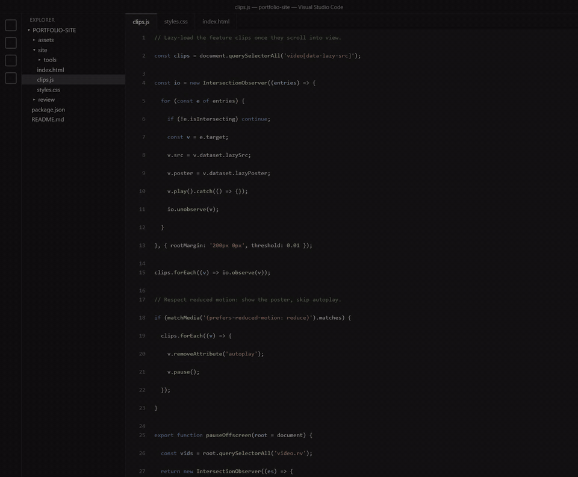

# Anti-Raycast

A keyboard launcher for Windows that stays out of your way. Tap the Windows
key, type, press Enter. Apps, files, notes, calculator, clipboard history,
emoji, window switching and your own actions, in one small palette.



## Why I built it

I liked Raycast's idea but not its footprint: its background process sat at
around 40% CPU and my laptop ran hot. So I built a launcher with the opposite
rule. Only a ~25 MB standard-library stub stays resident, and a watchdog in
that stub kills the palette if it ever uses too much CPU or memory.

## Requirements

- Windows 10 or 11
- Python 3.11 or newer
- Optional: [ripgrep](https://github.com/BurntSushi/ripgrep) for searching
  inside notes (on PATH, or the copy bundled with Cursor/VS Code is used)
- Optional: [Obsidian](https://obsidian.md) for note search and opening notes
- Optional: [Cursor](https://cursor.com) with Claude Code for the `.` ask command

## Install

```powershell
py -3.12 install.py
```

This creates a `venv`, installs PyQt6, rapidfuzz, pywin32, PyYAML and emoji,
and adds a shortcut (`Flint.lnk`, the project's old name) to your Startup
folder. Run the command it prints to start now, or sign out and back in.

Optional: copy `snippets.example.yaml` to `snippets.yaml` and add the text
you paste often. `snippets.yaml` is git-ignored.

## Use

**Tap the Windows key** (press and release, nothing in between) to open the
palette. Win+E, Win+D, Win+L and other Win combos work as normal. The Start
menu on a bare Win tap is suppressed; use Ctrl+Esc or click Start. Tap Win
again, press Esc or click away to hide it.

| Type | You get |
|---|---|
| an app name | fuzzy match over Start menu and Store apps |
| a file name (3+ chars) | results from the Windows Search index |
| a note name | notes from the Obsidian vaults in `config.yaml` |
| `?` terms | search inside your notes (ripgrep) |
| `2+2*3`, `sqrt(144)` | calculator, Enter copies the result |
| `72 f to c`, `5 km to mi` | unit conversion |
| `:` name | emoji picker |
| `clip` | clipboard history; Ctrl+Enter pastes into the previous window |
| `snip` | your snippets from `snippets.yaml` |
| `recent` | recently opened files |
| `w` name | switch to an open window |
| `sys` | battery, memory and power scheme |
| `kill` name | force-close a program (always asks first) |
| `note` text | append a timestamped line to your capture file |
| `.` request | open a new Claude Code session in Cursor with your request |
| `g` / `yt` / `maps` / `gh` / `wiki` terms | web searches (edit `searches:` in `actions.yaml`) |
| `>` | your custom actions and built-ins (refresh index, restart) |

Ctrl+Enter is the secondary action: show a file in its folder, copy a note
link, open an app's install folder, paste a clipboard item, or keep the
emoji picker open.

Results you pick often move up over time.

## Configure

Edit `config.yaml`. Changes apply the next time you open the palette.

- `hotkey`: `win` (default) or a combo such as `ctrl+alt+space`
- `watchdog`: CPU and memory limits for the palette process
- `vaults`: Obsidian vaults for note search, e.g. `MyVault: ~/Documents/MyVault`
- `capture_file`: where `note` writes (default `~/Documents/Inbox.md`)
- `aliases`: extra names for apps
- `scoped_dirs`: folders to search when Windows Search is unavailable

Custom actions and web searches live in `actions.yaml`. Plugins are Python
files in `plugins/` with a `query(q)` function; see `plugins/README.md`.

## How it stays light

| Piece | Budget | Enforcement |
|---|---|---|
| stub (`launcher.py`, always running) | ~25 MB, 0% CPU idle | standard library only, waits on the Windows message loop |
| palette (started on first tap) | under 150 MB, ~0% idle | the stub kills it above 20% total CPU for 60 s, or above 300 MB |
| indexing | nothing while idle | rebuilt at start, on `> refresh index`, or once a day |

After a kill the next tap starts the palette again in about two seconds.

## Notes

- Clipboard history starts when the palette first opens in a session.
  Win+V still has the Windows clipboard history.
- `RESEARCH.md` has the notes I made while designing the ranking and UI.

## Uninstall

Delete `Flint.lnk` from `shell:startup`, end the two `pythonw` processes
running from this folder, and delete the folder.

## License

MIT. See `LICENSE`.
